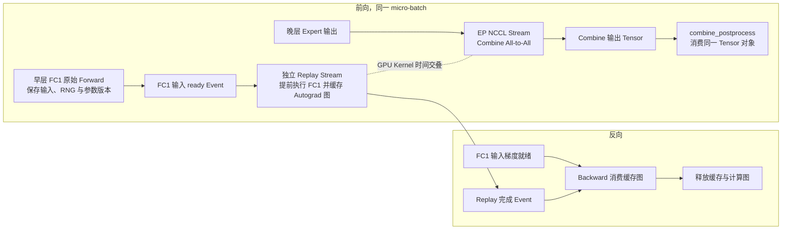

# P17 补充实验：MoE FC1 主动重计算与 EP Combine 并发

## 1. 核心摘要（Executive Summary）

本阶段将现有 `ProactiveCheckpoint` 接入 TEGroupedMLP 的 MoE FC1，并在 8 卡 EP8 上验证同 micro-batch 的早层 FC1 Replay 可与晚层真实 EP Combine All-to-All 并发。三个 Gate 均通过：提前图在 8 rank 完整数值对照中被正确消费；NSYS 观察到不同 CUDA Stream 上的 NCCL 与 FC1 GEMM Kernel 真实交叠；但并发模式没有提升整步吞吐，反而比同触发点串行 Replay 慢约 4.2%。整步差异远大于本次目标 Replay 的 GPU Kernel 时间，来源仍未能充分归因。**建议 P18 GO，仅开展受控通信计算竞争测量；不据此宣称加速，也不扩大成通用调度器。**

- **Gate A：PASS。** FC1 原始 Forward 一次、提前 Replay 一次、Backward 消费缓存图且不再重放；EP2 三步和 EP8 目标实例均通过逐元素字节相同对照，缓存及时释放。
- **Gate B：PASS。** EP8 C2 在 24 个 rank-step 候选中有 14 个观测到 FC1 GEMM 与 `ncclDevKernel_SendRecv` 重叠；同触发点串行 C1 为 0/24。FC1 输入、参数版本、RNG 和输出消费身份检查均通过。
- **Gate C：PASS（限于受控候选）。** 三次正常运行中 C2 为 344.32 ± 4.24 ms/step，同触发点串行 C1 为 330.46 ± 0.61 ms/step；C2 慢 4.2%。trace 显示潜在通信竞争，但单个 Kernel 驻留差异不能解释整步差值。
- **P18：GO（窄范围）。** 优先测试 EP8 前向 Combine × 早层 `moe_fc1` Replay，并保留同触发点串行对照、空触发对照及真实整步测量；尚不启动多通信原语矩阵。

## 2. 实验环境与方法

| 项目 | 配置 |
|---|---|
| 硬件与互联 | 单机 8×NVIDIA A100 SXM4 80GB；GPU 对之间拓扑记录为 NV12 |
| 软件 | PyTorch 2.7.0a0+79aa17489c.nv25.04、Transformer Engine 2.2.0+c55e425、NCCL 2.26.3、NSYS 2025.2.1；BF16 |
| 并行组 | TP1 / PP1 / CP1 / EP8；8 个 rank；本配置 Dense DP=8、Expert DP=1。另用 EP2 完成 Gate A 对照 |
| 模型 | GPT 6 层、hidden 512、attention heads 8、expert FFN 2048；8 experts、Top-2；约 0.11B 参数 |
| 数据与训练 | mock tokens、seed 42、Adam、LR 1e-4 至 1e-5 cosine decay、sequence 2048、MBS1、GBS32；每 rank 每步 4 个 micro-batch，全局每步 65,536 tokens |
| MoE 路径 | Megatron 原生 `MoEAlltoAllTokenDispatcher`、原生 EP All-to-All、TE `TEGroupedMLP`；无 token dropping/padding 配置 |
| 确定性设置 | `NCCL_ALGO=Ring`、`NVTE_ALLOW_NONDETERMINISTIC_ALGO=0`、`CUBLAS_WORKSPACE_CONFIG=:4096:8`；确定性实验模式 |
| 并发连接 | `CUDA_DEVICE_MAX_CONNECTIONS=2` 用于正式 C0/Cnoop/C1/C1serial/C2 对照；连接数 1 的初始 C2 试验保留为“未观察到重叠”对照 |
| 正常计时 | 每种模式 3 次独立 50-step 训练；前 20 步 warmup，后 30 步取均值；不启用 profiler |
| NSYS 诊断 | 正常性能数据之外独立采集；分析稳态迭代 20–22；NVTX 标记目标 Combine、consumer、FC1 前向/Replay 和 Backward |

测试模式定义如下。它们都只选取 layer 1 / micro-batch 0 的一个 FC1 实例；目标通信是 layer 3 / 同 micro-batch 的前向 Combine。

| 模式 | 目标 FC1 行为 |
|---|---|
| C0 | 原生按需 checkpoint/recompute |
| Cnoop | 经过实验触发路径但不提前执行 Replay，Backward 仍按需重算 |
| C1 | FC1 前向后立即执行 Proactive Replay，作为安全位置机制对照 |
| C1serial | 在目标 Combine API 返回后、计算流上执行同一 Replay；与 C2 使用相同触发点 |
| C2 | 目标 Combine API 返回后，在独立 Replay Stream 上执行 FC1；Replay Stream 仅等待 FC1 输入 ready Event，不等待 Combine 完成 |

显存记录区分 PyTorch `allocated` 与 `reserved` 峰值。NSYS 中的 NCCL Kernel 驻留、Replay Kernel 时间和 GPU 时间交集只用于机制观察，不用于推导正常吞吐。

## 3. 正确性与观测完整性验证

正确性比较使用完全相同的初始参数、优化器状态、随机状态、micro-batch 输入、路由结果和训练配置。张量比较采用原始字节逐元素相等，未放宽 BF16 容差。

| 验证 | 覆盖 | 结果 |
|---|---|---|
| Gate A 安全位置 EP2 | 8 rank、3 steps；每 rank 每 step 6 层 × 4 micro-batch；完整有效梯度、参数更新及输入梯度 | Proactive 与原生按需版本逐字节相同；每 rank 72 个 checkpoint 实例，全部 consumed/released，缓存归零 |
| Cnoop/C1/C2 与 C0 自对照 | EP8、8 rank、3 steps；每 rank 覆盖完整参数与梯度，并记录输出、Loss、Router 路由及 Expert 输入梯度 | 各模式每步全部张量覆盖均为零差异；没有缺失键或容差违规 |
| C1serial 与 C0 自对照 | 与 C2 相同候选和触发点，8 rank、3 steps | 所有被比较张量逐字节相同 |
| FC1 实例调用 | 两个独立 EP8 trace，每个 8 rank × 23 steps | 每实例 Forward 1 次、prefetch 1 次；Backward 没有再次调用 FC1 函数；消费时图含 `grad_fn` 且状态为 consumed |
| Replay 输入与参数 | 同上，共 184 个目标实例/trace | Forward 与 prefetch 的输入 pointer/shape/version 一致；保存 RNG 存在；参数版本到 consume 未变化 |
| Combine 下游身份 | 同上，共 184 个目标 Combine/trace | `token_combine` 返回对象与 `combine_postprocess` 消费对象是同一对象且 storage pointer 相同 |
| 生命周期 | Gate A、C1/C2 三步正确性及 50-step 正常性能运行 | 目标图消费后释放；无跨 step 悬留；运行结束 checkpoint 注册表和缓存计数归零 |

上述逐字节对照覆盖了每 rank 的有效 `main_grad`、更新后参数、优化器状态、输入 token、Forward 输出和 Loss；EP8 诊断另保存 Router routes 与 Expert 输入梯度。此结论只适用于所测 BF16/TE、mock-data、单机配置。

在 23 个稳态 trace step 中，目标 FC1 的本地输入行数随 rank 和路由变化，观测范围为 3,424–5,059 行（hidden 512）；该值是 rank 汇总的专家 token 行数，不是单个 expert 的负载分布。

## 4. 性能评估与定量测量

步时和 Token/s 以三次独立正常训练的运行均值计算；“±”为三个运行均值之间的样本标准差。变化相对 C0。显存是每次运行所有 rank 的最大峰值范围。

| 模式 | 整步 ms（均值 ± SD，n=3） | 对 C0 | Token/s | Token/s 对 C0 | allocated GiB | reserved GiB |
|---|---:|---:|---:|---:|---:|---:|
| C0 | 327.82 ± 4.20 | 基线 | 199,915 | 基线 | 1.0687 | 1.3770–1.3906 |
| Cnoop | 327.49 ± 4.13 | −0.10% | 200,114 | +0.10% | 1.0687–1.0700 | 1.3770–1.3789 |
| C1，立即 Replay | 339.17 ± 1.97 | +3.46% | 193,225 | −3.35% | 1.0724–1.0737 | 1.3926–1.3945 |
| C1serial，同触发点串行 | 330.46 ± 0.61 | +0.81% | 198,315 | −0.80% | 1.0725–1.0735 | 1.3926–1.4121 |
| C2，Combine 期间尝试并发 | 344.32 ± 4.24 | +5.03% | 190,334 | −4.79% | 1.0717–1.0726 | 1.4121–1.4316 |

- Cnoop 与 C0 基本一致，说明固定实例的实验触发路径自身没有可见的整步开销。
- C2 比相同触发点、相同 Replay 工作量的 C1serial 慢 13.86 ms/step（+4.19%）；本实验未测得端到端加速。
- C2 allocated 峰值比 C0 高约 3.1–4.0 MiB；C2 reserved 峰值比 C0 最高值高约 42 MiB。缓存 Forward 输出大小为每 rank 13.66–21.10 MB；该字节数不等于全部新增峰值显存。
- 所有模式均完成 50 steps，无 skipped/NaN；各自末步 loss 为 0.4798779，梯度范数为 0.341。

NSYS 区间按 8 rank × 3 稳态 steps 统计，包含每 rank 一个候选调用。以下为两次独立 C1/C2 trace 的 rank-step Kernel 驻留中位数范围，以及一个代表性 C2 trace 的交集：

| 诊断量 | C1serial | C2 并发尝试 | 说明 |
|---|---:|---:|---|
| Combine NCCL Kernel 中位数 | 0.644–0.693 ms | 0.828–1.057 ms | 每次 trace 内 24 个 rank-step 样本；C2 中位数更高，支持通信可能受竞争影响，但不是隔离服务时间 |
| FC1 Replay GEMM 中位数 | 52.75–53.23 μs | 53.20–53.30 μs | Kernel 级差异较小；并发没有消除 Replay 工作量 |
| Combine 与 FC1 GEMM 有交集 | 0/24 | 14/24（两次 C2 trace 均为 14/24） | C2 重叠发生在 NCCL stream 与独立 Replay stream；C1serial 为计算流串行 |
| Combine 与任一目标 Replay Kernel 有交集 | 0/24 | 15/24 至 19/24 | 各 C2 trace 的 rank-step 计数不同；小型样本不解释所有 rank 差异 |
| C2 单 trace GEMM 交集 | 不适用 | 均值 32.26 μs、 中位数 52.72 μs，n=24 | C2 trace 中目标 GEMM 中位数 53.30 μs；Kernel 时间相交不等于等量关键路径被隐藏 |

对 C2 下游依赖的单 trace 分析显示，目标 NCCL Kernel 结束到 `combine_postprocess` 首个 GPU Kernel 开始的间隔中位数为 256 μs（范围 0.96–2,204 μs）。24 个样本中有 14 个间隔内没有观测到其他 CUDA Kernel；其余样本存在其他 Kernel。**这只说明目标通信后的 Kernel 调度间隔，不将其直接解释为整步关键路径等待或可用 Replay 容量。**

## 5. 深度分析与机制探讨

FC1 Replay 的输入来自同一 micro-batch 的 layer 1；目标 Combine 是 layer 3 前向 MoE 通信。物理上，Replay 需要较早 FC1 输入和当前参数，而 Combine 输出由较晚层专家输出经 EP All-to-All 汇回，因此二者拥有不同输入依赖。

**直接实测结果：** FC1 输入 pointer 和版本在原始 Forward 与 prefetch 中相同，Replay 时参数版本不变，RNG 快照存在，Backward 消费时预构建图仍有 `grad_fn`。目标 Combine 返回的张量由后续 postprocess 以同一对象和 storage 消费。C2 的 Replay Stream 在 FC1 输入 ready Event 后运行，不等待 Combine；Backward 等待 Replay 完成后消费图。完整梯度、Expert 输入梯度和更新参数均与 C0 逐字节相同。

**Kernel 时间线：** C2 的 NCCL `ncclDevKernel_SendRecv` 位于通信 stream，FC1 Replay GEMM 位于独立 stream；多 rank-step 上两者的 GPU Kernel 时间区间相交。CUDA_DEVICE_MAX_CONNECTIONS=1 的初始 C2 尝试没有交集；连接数为 2 后才观察到真实交叠。C1serial 在同一触发点执行同样 Replay，但 trace 中没有 NCCL/GEMM 重叠。

NSYS 观察到 C2 Combine 驻留中位数高于 C1serial，而 GEMM 中位数基本接近。**一种可能解释是并发增加了 NCCL 侧等待或共享 GPU 资源竞争；现有 trace 未提供硬件资源计数器，不能把全部驻留差额归为带宽或 SM 竞争。**

正常训练中 C2 比 C1serial 慢约 13.86 ms/step，而目标 Replay GEMM 约 53 μs，前向/Backward 的目标 CPU 范围在 C2 相比 C1serial 仅增加约 0.1/0.04 ms。已测到的局部范围不能解释整步差值。可能还涉及其他未隔离的 Stream 排队、运行时同步、CPU 提交次序或跨层资源影响；当前证据无法在这些因素间定量归因。

本阶段没有证明 C2 存在可隐藏的“同量”训练工作，也没有将 Combine 驻留或 Kernel 交集换算成加速上界。当前最有价值的结论是：**该组合确实可以合法并发，且并发可能恶化通信 Kernel 驻留和端到端步时；它适合作为后续受控竞争实验候选，不适合作为当前优化方案。**

## 6. 局限性、决策建议与后续工作

- **模型代表性有限：** 约 0.11B 参数、单机 A100、8 experts、Top-2、seq2048、mock tokens；没有真实语料、长时间收敛、多节点或长序列验证。
- **路由负载范围有限：** 确定性 mock 路由可复现且实际产生非退化 token 分配，但本阶段不代表生产语料分布；没有开展大范围 router skew 搜索。
- **Profiler 范围有限：** 每个模式使用少数独立 trace，Kernel 驻留受 NCCL 调度和 profiler 影响；CUDA Event API 可见，但 NSYS 导出的数据未包含 event handle 映射，因此无法对每个 Event 逐一还原依赖图。
- **关键路径归因有限：** 目标 Combine 输出身份和下游 GPU consumer 已确认；但多流全局关键路径、纯 GPU idle、CPU 调度贡献及 13.86 ms 整步差异尚未闭合。统计中的“没有其他 Kernel”不排除 memcpy 或其他非 Kernel GPU 活动。
- **显存解释有限：** 输出缓存字节数是缓存张量大小；allocated/reserved 峰值差值受 allocator 缓存和训练其他激活影响，不能视为单个 checkpoint 的独立峰值成本。
- **P18 建议：** GO，但只推进 EP8 的 Combine × FC1 单实例资源竞争对照，继续采集 C0/Cnoop/C1serial/C2；至少三次独立正常训练，并做独立多次 NSYS。优先定位 C2 的 NCCL 驻留变化和整步额外 13.86 ms，加入每 rank 的 Compute/NCCL stream wait 与全设备 Kernel 间隙统计。未完成这些测量前不扩展到 Dispatch、多 Replay 或自动调度器。

## 7. 附录：数据溯源与档案索引

| 正文证据 | 文件与字段 |
|---|---|
| 实验环境及既有 EP 进程组 | P17 基线报告的环境表、`environment_nvidia.txt`、`environment_software.txt`、`topology.txt`；逐 rank process group 记录见 P17 `logs/*.rank*.jsonl` 的 `groups` |
| Gate A 完整数值对照 | `gate_a_20261126/compare_step{0,1,2}.json` 与 `correctness_summary.json`：各 rank 的 `initial`、`observed`，包括完整参数、优化器、梯度、输入梯度、输出与 loss；`lifecycle_summary.json`：实例数、事件数及 cache bytes |
| Gate B C0/Cnoop/C1/C2 与 C1serial 对照 | `gate_b_20261126/compare_*.json`、`correctness_C{1,2,Cnoop}_summary.json` 及 `gate_c_20261126/correctness_C1serial_summary.json`：每 rank / step 的 `initial`、`observed` tensor 元素覆盖、`different`、`violations`；`entry.py`、`entry_serial_control.py`、`launch.sh` |
| 单实例身份、输入版本、参数版本、RNG、图消费、Combine consumer 身份 | `gate_c_20261126/runtime_audit_C1_r1.json`、`runtime_audit_C2_r2.json`；原始 rank 级 `*.calls.rank*.jsonl` 和 `*.consumers.rank*.jsonl` 在本地结果目录 |
| 正常性能 | `gate_c_20261126/performance_all.json`，由 `summarize.py` 读取每次日志第 21–50 步和逐 rank 峰值记录生成；`steady_ms_mean/std`、`max_allocated`、`max_reserved`、`tokens_s`、`final_loss`、`final_grad_norm`。原始日志位于本地结果目录 |
| Replay 与 Combine Kernel 交集 | `gate_c_20261126/concurrency_C1_serial_profile_r1.json`、`concurrency_C2_profile_r2.json`、既有 `gate_b_20261126/concurrency_C1_conn2.json` 和 `concurrency_C2_conn2.json`；字段 `samples`、`overlapped_gemm_samples`、`combine_us`、`gemm_us`、`gemm_overlap_us`、`overlap_us` |
| Combine 到真实下游 consumer 的间隔 | `gate_c_20261126/dependency_C2_r2.json`；每 rank-step 的 `combine_kernel`、`combine_streams`、`consumer_stream`、`combine_end_to_consumer_kernel_us`、`kernels_between_comm_end_and_consumer` |
| CPU NVTX/Runtime 范围分解 | `gate_c_20261126/scopes_C1_serial_r1.json`、`scopes_C2_r2.json`；`parent_us`、`child_forward_us`、`cuda_api_outside_child_us`、`remaining_wall_us` 为不重叠区间统计，不能解释成 CPU 硬件耗时 |
| 复现脚本与源码 | `gate_a_20261126/run_correctness.sh`；`gate_b_20261126/launch.sh`、`entry.py`、`entry_serial_control.py`；`gate_c_20261126/run_performance.sh`、`run_serial_correctness.sh`、`run_serial_performance.sh`、`run_profiles.sh`、`analyze_concurrency.py`、`analyze_consumer_dependency.py`、`analyze_scopes.py`、`summarize_runtime_audit.py`；实验机制源码改动在 `megatron/core/transformer/moe/experts.py`，接口说明在 `docs/research/layerwise_recompute.md` |
| 基线与 Git | 实验基线提交 `8f40b31134b2d2f54955c982b4d3bbca43ca8bb6`；本报告最终提交见其所在分支最新 commit。分支 `research/p17-moe-ep-20261124` |
| 本地大文件 | Gate A 张量快照位于 `/mnt/si002365wekc/zwx/code/recom/qwen3_bench/results/p17_gate_a_20261126/{reference3,proactive3}/step*/`；Gate B 快照位于 `/mnt/si002365wekc/zwx/code/recom/qwen3_bench/results/p17_gate_b_20261126/{C0,C0_conn2,C1,C1_conn2,C1_serial,C2,C2_conn2,Cnoop_conn2}/step*/`，其中 C1serial 使用 `C1_serial`。NSYS traces 位于 `/mnt/si002365wekc/zwx/code/recom/qwen3_bench/results/p17_gate_c_20261126/`，包括 `C0_profile_r1.nsys-rep`、`Cnoop_profile_r1.nsys-rep`、`C1_profile_r1.nsys-rep`、`C1_profile_r3.nsys-rep`、`C2_profile_r1.nsys-rep`、`C2_profile_r2.nsys-rep`、`C2_profile_r3.nsys-rep`；分析用 SQLite 为 `C1_profile_r1.sqlite` 和 `C2_profile_r2.sqlite`。正常性能日志也在该目录。以上大文件均保留本地、未纳入 Git。`C1_profile_r2.nsys-rep` 本轮重采集被中断，现为不完整文件，排除统计。 |
