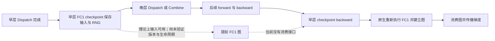

# P17：提前 Replay 可消费性审查（未完成实验验收）

## 1. 核心摘要（Executive Summary）

**PARTIAL；P18 NO-GO。** 本次源码审查确认，MoE FC1 的原生 checkpoint 不提供提前生成计算图的消费接口。仅提前运行 FC1 不能消除后续原生 Replay，因此目前没有可证明的实现收益上界。

- 较早层 FC1 的输入不需要较晚层 Dispatch/Combine 的输出，这是静态拓扑判断，尚未完成运行时版本和别名验证。
- 原生 backward 无条件重新执行保存的函数，并消费新建立的计算图；提前建立的图不会自动替代它。
- 已有局部 Event 证据不能给出可移动工作的关键路径贡献。
- 本次未新增训练或三次成本重复；相关验收条件未完成，不使用既有单次 profiler 结果替代。

## 2. 实验环境与方法

| 项目 | 范围 |
|---|---|
| 方法 | 当前 P17 分支源码与已归档报告审查 |
| 新训练/Profiler | 未执行 |
| 训练路径变更 | 无 |

## 3. 正确性与观测完整性验证

沿用已有确定性 EP2 首步完整张量验证的证据范围；本次没有改变 Replay 执行路径。未新增 EP8 的图缓存、参数版本、输入别名和缓存释放验证。

## 4. 性能评估与定量测量

| 指标 | 本次结果 |
|---|---|
| 提前 Replay 正常训练收益 | 未测量 |
| 提前图缓存显存 | 未测量 |
| 三次独立成本归因 | 未完成 |
| 合法且可实现的收益上界 | 未知 |

## 5. 深度分析与机制探讨

一个 Replay 只有在输入可用、参数/RNG 语义保持一致，而且后续 backward 能消费它的图时，才可能替代原有工作。

FC1 闭包捕获当前专家模块与 token split，checkpoint 保存输入和 RNG；权重并未复制成独立版本。静态最早时刻是该 FC1 输入及 split 完成并且可重放状态已保存之后，最晚期限是对应 checkpoint backward 需要其输出图之前。实际 GPU 就绪时间、参数版本稳定性和保留显存尚未知。

普通 checkpoint 的 backward 恢复 RNG、detach 保存输入、开启梯度后重新执行函数，再调用 autograd backward。它既不查询提前图缓存，也不具有提前图的单次消费与释放协议。此时额外提前计算 FC1 不会使原有 Replay 消失；要验证收益，需要明确的小范围图消费接入及全 rank 正确性/生命周期验证，而不是仅安排另一条流运行 GEMM。

已有 Event 样本支持晚层通信与后续计算流之间的顺序；未证明早层 FC1 提前图在该时间段的可消费性。通信驻留不能充当可隐藏容量，静态无数据依赖也不能替代执行合法性证明。

## 6. 局限性、决策建议与后续工作

本次仅完成静态审查，未完成用户要求的运行时候选身份、版本和期限观测、三次独立成本归因与额外显存测量，因此不能宣布本轮实验验收完成。

优先观察一个早层 FC1 checkpoint 与一个晚层 EP8 Combine 的输入/RNG/参数版本及 backward 身份，再评估最小的提前图消费接入是否值得实现。若接入执行路径，必须重新执行全部 8 rank 梯度、更新后参数和缓存生命周期验证。候选仍是同 micro-batch 早层 FC1 与晚层 EP8 Combine，P18 暂不 GO。

## 7. 附录：数据溯源与档案索引

- 审查基线：`9b07f987357dee8f7146e160e1512357aa6df65e`。
- 既有证据：`../followup_20261125/EXPERIMENT_REPORT.md` 及同目录 JSON、事件样本与脚本。
- FC1 闭包和调用：`megatron/core/transformer/moe/experts.py` 的 `TEGroupedMLP.forward`。
- 保存、RNG 恢复、无条件 Replay 和图消费：`megatron/core/tensor_parallel/random.py` 的 `CheckpointFunction.forward/backward`。
- 本次无新增大型文件；既有 trace 和张量路径见前次报告附录。
