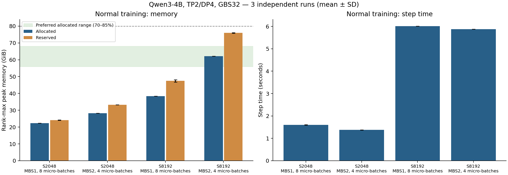
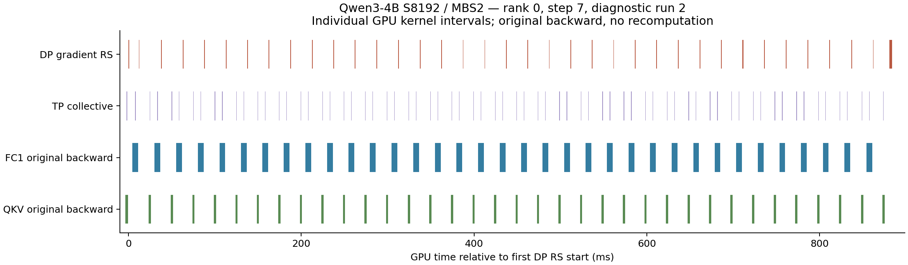

# Qwen3-4B 阶段 A/B：加载可行性、显存压力与原生 DP 通信窗口

## 1. 核心摘要（Executive Summary）

本轮验证 Qwen3-4B 能否在既有 TP2/DP4 环境中稳定训练，并筛选值得开展细粒度重计算的负载。**真实权重加载及四种无重计算负载均通过验证；建议有限 GO，优先将 Seq8192/MBS2 提交阶段 C 审阅。** 该负载 allocated 峰值为 62.077 ± 0.001 GiB，正式整步耗时为 5876.65 ± 0.52 ms。当前结果只支持负载可行性与原生通信位置判断。

- **压力区间作为优先级。** Seq8192/MBS2 的 allocated 占标称 80 GiB 的 77.60%；Seq8192/MBS4 探测 OOM，MBS8 未测量。低压力参考仍保留。
- **正式性能与诊断分开。** 四负载各三次独立运行，每次 20 步 warmup＋30 步正式测量；另做独立全 rank NSYS 诊断。
- **通信跨度不等于通信容量。** Seq8192/MBS2的RS驻留为 82.68 ± 7.53 ms，占诊断整步 1.41 ± 0.13%；首尾跨度为 902.90 ± 5.11 ms，且只出现在最后一个累积micro-batch。
- **重叠机会仍需验证。** 长序列QKV原始反向与RS交集为0，FC1仅第34层有交集。本轮未启用重计算，不能把原始反向交集解释为重计算收益。

## 2. 实验环境与方法

| 项目 | 配置 |
|---|---|
| 硬件 | 单机 8×A100-SXM4-80GB，NV12；标称每卡80 GiB |
| 模型 | Qwen3-4B，36层，hidden2560，FFN9728，32 Q heads / 8 KV heads，head_dim128 |
| 权重与数据 | 加载本地真实HF BF16权重；mock token训练；共享输入/输出embedding |
| 精度与并行 | BF16，TP2/DP4、PP1、CP1，序列并行关闭 |
| 优化器 | Distributed Optimizer；Adam lr=1e-4，betas=(0.9,0.95)，weight decay=0.1，clip-grad=1 |
| 通信 | 原生异步DP梯度Reduce-Scatter；目标bucket=40M元素，FP32梯度；参数All-Gather重叠关闭 |
| 固定参数 | GBS32，seed1234，CUDA_DEVICE_MAX_CONNECTIONS=1，OMP_NUM_THREADS=4 |
| 软件 | 驱动570.172.08；PyTorch 2.7.0a0+79aa17489c.nv25.04；CUDA runtime 12.9；NCCL 2.26.3；TE 2.2.0+c55e425；NSYS2025.2.1 |
| 对照负载 | Seq2048/MBS1、2；Seq8192/MBS1、2；其余OOM/跳过状态另列 |

**先固定通信机制，再改变负载。** 本轮沿用P1原始GBS32、TP2/DP4、PP1及同一bucket目标；所有负载均无重计算，不包含关闭overlap、AR或新调度策略。

| 测量阶段 | 重复与步数 | 用途 |
|---|---|---|
| 加载验证 | 8rank完整逐张量copy检查；单样本8token独立前向；3步训练 | 核查映射及基本训练可行性 |
| 负载探测 | 每候选3步；OOM后跳过同序列更大MBS | 确定可运行边界，保留失败 |
| 正式测量 | 每成功负载3个独立进程，同种子；每次20warmup＋30正式步；区组内随机顺序 | 正常步时、吞吐、逐rank显存 |
| 4B时间线 | 四负载各3次独立NSYS；5warmup后采6–8步，共训练10步 | 通信与原始前后向位置 |
| 0.6B定向诊断 | 无重算B1，3次；与4B同观察器、预热和采样步 | 对齐观测方式后的窗口对照 |

正式步时采用Megatron逐步日志：运行内取30步中位数，再报告三个运行的均值±样本标准差；吞吐为正式名义token数除以正式总步时。Seq2048/8192每步分别处理65,536/262,144 token。

显存每步重置allocator峰值，剔除warmup后在8rank×30步上取最大值，再跨运行汇总。allocated与reserved分别报告；本轮未采集整卡NVML峰值。观察代码独立加载，不修改Megatron训练调度或数学计算。

## 3. 正确性与观测完整性验证

| 项目 | 覆盖及结果 |
|---|---|
| 权重映射 | 398个HF来源张量；按GQA组打包QKV，FC1按gate/up分片，FC2/输出投影按输入维分片；TP每rank290个唯一参数张量 |
| 加载检查 | 阶段A全部8rank逐张量完整copy比较通过，非抽样；其余运行检查全部键与形状 |
| 独立前向 | 1样本×8token，比较真实词表全部1,215,488个logits元素；relative L2=0.020592，cosine=0.999797708，max abs=0.3125 |
| 前向容差 | 运行前设relative L2≤0.03、cosine≥0.999；BF16独立参考通过 |
| 正常训练 | 12次正式运行均完成50步；各30个正式样本，loss及日志梯度范数有限，无记录到的跳步/NaN iteration |
| 诊断覆盖 | 4B共12次、0.6B共3次采集；每次8rank×3步；逐communicator协议、通信归属及CUPTI告警筛查 |
| 重放 | 所有采集均为0次，重放与DP交集为0；不包含阶段C对照 |

独立参考直接读取原始safetensors，以BF16执行RMSNorm、GQA、RoPE、因果SDPA及SwiGLU。真实词表151,936补齐到152,064，新增行置零；前向比较只覆盖真实词表。完整梯度张量等价、长期收敛及HF loss等价未测量。

## 4. 性能评估与定量测量

### 4.1 无profiler正常训练

各项为3次独立重复，百分比统一相对4B Seq2048/MBS1。

| Seq/MBS | 每步micro-batch | 整步ms，均值±SD | 步时变化 | token/s，均值±SD | 吞吐变化 |
|---|---:|---:|---:|---:|---:|
| 2048/1 | 8 | 1598.78 ± 10.28 | +0.00% | 39989 ± 385 | +0.00% |
| 2048/2 | 4 | 1375.47 ± 3.20 | -13.97% | 47214 ± 170 | +18.07% |
| 8192/1 | 8 | 6011.37 ± 2.03 | +276.00% | 43606 ± 12 | +9.05% |
| 8192/2 | 4 | 5876.65 ± 0.52 | +267.57% | 44591 ± 10 | +11.51% |

| Seq/MBS | allocated GiB，均值±SD | allocated变化 | reserved GiB，均值±SD | reserved变化 | allocated / reserved占标称80GiB |
|---|---:|---:|---:|---:|---:|
| 2048/1 | 22.289 ± 0.002 | +0.00% | 24.115 ± 0.104 | +0.00% | 27.86% / 30.14% |
| 2048/2 | 28.192 ± 0.000 | +26.48% | 33.275 ± 0.028 | +37.99% | 35.24% / 41.59% |
| 8192/1 | 38.365 ± 0.002 | +72.13% | 47.462 ± 0.686 | +96.82% | 47.96% / 59.33% |
| 8192/2 | 62.077 ± 0.001 | +178.51% | 75.922 ± 0.205 | +214.84% | 77.60% / 94.90% |

- Seq8192/MBS2是已测可运行负载中显存压力最大的组合。
- Seq8192/MBS4在探测首步发生OOM，无有效稳定步时或完整步峰值；MBS8未启动。
- 跨序列比较包含每步token数变化；同序列MBS比较保持每步token数相同。

### 4.2 原生DP通信与计算交集

通信窗口需要区分“通信占据GPU的时间”和“从第一条通信开始到最后一条结束的跨度”。后者还包含bucket间的间隙，不能全部当作可利用通信容量。

令D为DP梯度RS GPU kernel区间的并集，B为原始反向非NCCL kernel并集，则通信驻留为|D|，反向交集为|D∩B|；跨度为max end(D)−min start(D)。DP占比为|D|/诊断整步跨度。

下表均为独立NSYS数据：每次先平均8rank×3步，再报告三个运行的均值±SD；变化以4B Seq2048/MBS1为基线。它们不用于正常步时排名。

| 模型 Seq/MBS | RS驻留ms | 相对参考 | 整步占比 | 首尾跨度ms | 原始反向∩RS ms | RS内无非NCCL kernel交集ms |
|---|---:|---:|---:|---:|---:|---:|
| 0.6B 2048/1 | 78.68 ± 13.76 | -23.35% | 5.28 ± 1.00% | 99.02 ± 7.27 | 22.34 ± 3.83 | 56.33 ± 10.21 |
| 4B 2048/1 | 102.64 ± 11.11 | +0.00% | 5.23 ± 0.52% | 186.53 ± 10.53 | 55.21 ± 3.80 | 47.43 ± 10.73 |
| 4B 2048/2 | 51.27 ± 1.62 | -50.05% | 3.69 ± 0.12% | 224.18 ± 1.75 | 41.64 ± 1.55 | 9.64 ± 0.28 |
| 4B 8192/1 | 71.20 ± 1.34 | -30.64% | 1.19 ± 0.02% | 492.54 ± 1.57 | 54.63 ± 0.49 | 16.57 ± 1.40 |
| 4B 8192/2 | 82.68 ± 7.53 | -19.45% | 1.41 ± 0.13% | 902.90 ± 5.11 | 70.00 ± 5.65 | 12.68 ± 2.00 |

| 模型 Seq/MBS | 活跃bucket数/步 | 首bucket ready ms | 末bucket ready ms | 首RS GPU开始ms | 末RS GPU结束ms | Work.wait CPU总ms |
|---|---:|---:|---:|---:|---:|---:|
| 0.6B 2048/1 | 6 ± 0 | 1367.48 ± 20.99 | 1454.19 ± 15.62 | 1370.14 ± 20.74 | 1469.16 ± 13.59 | 0.107 ± 0.010 |
| 4B 2048/1 | 37 ± 0 | 1718.23 ± 16.87 | 1901.55 ± 22.51 | 1722.93 ± 16.49 | 1909.46 ± 22.07 | 0.526 ± 0.053 |
| 4B 2048/2 | 37 ± 0 | 1102.71 ± 4.62 | 1330.37 ± 2.99 | 1114.89 ± 3.46 | 1339.07 ± 2.68 | 0.561 ± 0.014 |
| 4B 8192/1 | 37 ± 0 | 5405.29 ± 3.11 | 5916.69 ± 4.14 | 5437.50 ± 3.65 | 5930.04 ± 4.14 | 0.644 ± 0.048 |
| 4B 8192/2 | 37 ± 0 | 4820.09 ± 6.95 | 5777.78 ± 11.12 | 4895.27 ± 6.94 | 5798.17 ± 11.09 | 0.656 ± 0.034 |

各rank跨3次重复的平均RS驻留范围如下，完整逐rank SD保留在附录数据中。

| 模型 Seq/MBS | 各rank平均RS驻留最小–最大 ms |
|---|---:|
| 0.6B 2048/1 | 46.71–127.61 |
| 4B 2048/1 | 72.06–145.79 |
| 4B 2048/2 | 47.22–56.47 |
| 4B 8192/1 | 33.99–104.97 |
| 4B 8192/2 | 34.89–124.63 |

时间均相对各rank本步CPU标记起点；ready指进入原生start_grad_sync的CPU逻辑就绪观测点，不代表梯度GPU kernel已完成。Work.wait为主机API区间，不等同GPU通信等待或关键路径暴露时间。

### 4.3 同序列MBS对照

| 对照 | micro-batch变化 | 正常步时变化 | allocated增量 | RS驻留变化（诊断） | 原始反向∩RS变化（诊断） |
|---|---:|---:|---:|---:|---:|
| 2048，MBS1→2 | 8→4 | -13.97% | +5.902 GiB | -51.37 ms | -13.58 ms |
| 8192，MBS1→2 | 8→4 | -2.24% | +23.711 GiB | +11.48 ms | +15.36 ms |

具体窗口位置、逐层QKV/FC1原始反向交集与协议核验见下一节。

## 5. 深度分析与机制探讨

### 5.1 累积过程决定窗口出现在哪个micro-batch

**直接实测：全部15份时间线中的梯度RS都只在最后一个累积micro-batch提交。** MBS1为mb7，MBS2为mb3；更早micro-batch的反向与DP梯度RS交集均为0。这与原生DDP只在最后一次累积标记梯度ready的路径一致。

4B各负载活跃bucket均为37个，每rank每步RS输入合计8,045,983,744字节；同模型跨负载、重复和rank的bucket成员、dtype及大小签名一致。改变MBS未改变每步RS数据量，但改变最后一次反向的工作量与bucket间隔。

**机制解释：** 增大MBS把同样的全局token集中到更少次前后向中，因此同时影响矩阵效率、host开销、TP调用次数和最终反向持续时间。正常步时变化不能单独归因于DP重叠；RS时长变化也不代表有效传输量发生变化。

### 5.2 模型与序列变大，不等于通信容量同比增加

同观察器、同预热的Seq2048/MBS1诊断中，0.6B的RS驻留为78.68 ± 13.76 ms，4B为102.64 ± 11.11 ms，均值变化+30.46%。诊断整步占比分别为5.28 ± 1.00%与5.23 ± 0.52%，没有显示通信占比随模型增大而明显上升。活跃bucket从6个变为37个；输入字节从1,192,493,056变为8,045,983,744。

固定模型时，Seq2048→8192使每步token数增至4倍，梯度通信字节数保持不变。**首尾跨度与实际驻留必须分别看待：前者随反向计算展开而拉长，间隙仍不是通信窗口。** 表中驻留、占比与交集是实际观测，不由模型参数量或序列长度推算。

**直接实测：相同负载的rank平均RS驻留存在差异。** NCCL kernel驻留还包含同步与执行等待。有效传输、rank到达差、SM/HBM竞争和host提交间隔都可能影响其时长；这些是待验证因素，本轮没有带宽或硬件计数器证据区分它们。

### 5.3 QKV/FC1应按4B实际位置重新筛选

下表统计**原始反向**与RS的GPU区间交集，仅列最后一个micro-batch。为防止偶发交集误导层号选择，同时给出“曾出现交集”和“每次运行至少一半rank-step出现交集”的层号范围。层号均为0基全局层号。

| Seq/MBS | 模块 | 原始反向∩RS ms，3运行均值±SD | 曾出现交集的层 | 每次运行≥50% rank-step有交集的层 |
|---|---|---:|---|---|
| 2048/1 | QKV | 7.362 ± 1.459 | 0–34 | 30–34 |
| 2048/1 | FC1 | 3.526 ± 0.941 | 2–34 | 34 |
| 2048/2 | QKV | 1.394 ± 0.262 | 0、14–16、31–34 | 33–34 |
| 2048/2 | FC1 | 1.921 ± 0.187 | 15、34 | 34 |
| 8192/1 | QKV | 0.000 ± 0.000 | 无 | 无 |
| 8192/1 | FC1 | 4.444 ± 0.060 | 34 | 34 |
| 8192/2 | QKV | 0.000 ± 0.000 | 无 | 无 |
| 8192/2 | FC1 | 7.261 ± 0.637 | 34 | 34 |

示例为rank0的一个采样步，仅展示RS间隙及计算位置；逐rank差异见前表。

这些位置适合指导下一轮观测，**不能当作重计算任务已满足独立执行条件**。原始反向与checkpoint重放具有不同kernel顺序和输入/梯度依赖；重计算插入后也可能改变bucket就绪时刻。4B有36层，不能直接沿用0.6B的高层负向对照。

后续应先在固定压力负载上验证QKV的真实峰值收益，再按实际checkpoint重放位置确认正、负向窗口对照。FC1仍需保留受控成本诊断；本轮没有重放，不能确认或排除P1中的并发减速。

### 5.4 负载选择与工程含义

Seq8192/MBS2满足本轮的稳定性和优先压力目标，适合作为阶段C主负载；较高reserved意味着容量余量有限，失败记录应继续保留。Seq8192/MBS1提供同序列、不同累积次数的辅助对照；Seq2048/MBS1保持与既有基线的配置连续性。

这一负载选择优先满足稳定性与显存压力要求；它不把较长通信跨度视为已经获得的可隐藏重计算容量。

## 6. 局限性、决策建议与后续工作

**建议仅有限GO准备阶段C方案，执行仍需用户确认。** 优先Seq8192/MBS2，同时保留Seq8192/MBS1以检查MBS/累积影响，Seq2048/MBS1作为历史可比参考。70%–85%为负载优先区间；低于区间的负载仍可依据实际绝对显存收益保留有限验证。

1. 阶段C先比较同bucket无重算基线与五层QKV（可先用0–4作显存成本参照）的峰值allocated、正常步时及完整梯度/参数正确性；不预设低层为正向、高层为负向，实际重放区间出现差异后再确定位置对照。
2. FC1以第34层作为定位观察点，并保留低层受控比较；先验证独立成本和重放位置，再讨论资源竞争，不预设它适合重叠。
3. 只有实际显存下降超过波动、时间代价可接受，且位置对照支持重叠机制，才讨论显存预算策略选择；主动调度器维持NO-GO，尚无端到端加速证据。

本轮边界集中如下：

- 仅单机8×A100、BF16、TP2/DP4、PP1、GBS32和所列Seq/MBS；未覆盖其他MBS、拓扑、真实语料或长期训练。所有重复同seed，反映运行波动，不能估计跨seed收敛差异。
- 4B采用预训练权重，历史0.6B为随机初始化，结构和矩阵尺寸也不同。定向诊断对齐观察器及预热，但模型规模对比仍是配置层面的变化。
- 诊断预热5步，正式性能预热20步；历史P1诊断预热20步。不能将不同采集口径混合汇总，也不能把NSYS步时用于性能排序。
- 全部通信交集是时间区间交集；RS kernel可能包含等待和资源停顿。无非NCCL交集时也可能有TP通信，并非已证明的关键路径暴露或GPU空闲；Work.wait主机时间也不是GPU空闲时间。
- 未采集SM/HBM计数器、NVML峰值或通信带宽对照，不能因时间伴随断言资源争用。原始反向交集不等于额外重计算可隐藏容量。
- 未执行重计算，故实际重计算节省、并发减速、输入生命周期约束后的重计算容量及净步时收益均未测量；没有完整梯度等价或收敛等价证据。
- 词表padding及BF16实现差异限制独立前向对照范围；OOM首步的未完成allocator统计不能当作有效峰值。

阶段A/B结束后暂停；不执行阶段C、AR、主动重放或新调度器。

## 7. 附录：数据溯源与档案索引

本轮结果均位于本目录；下表相对路径以报告所在目录为起点。正文核心数字由汇总脚本直接读取JSON生成。

| 证据对象 | 原始文件/字段及用途 |
|---|---|
| 授权执行版规划 | `../../plans/QWEN3_4B_FEASIBILITY_PLAN.md`；本轮独立重建的A/B范围、步数与跳过规则，未声称恢复缺失旧规划 |
| 执行入口与结束状态 | `execution_commands.json`记录编排入口、复现参数及完成UTC时间；`orchestrator_suite.log`、`orchestrator_control.log`、`orchestrator_postprocess.log`保留编排日志；复现指定全新结果目录 |
| 源码版本 | `commit.txt`：`1e6e162a2c8becda003164b5395ae9b01c229b09`；`git_status.txt`记录分支与既有dirty项；`source.txt`保存原始diff；`source_hashes.json`为开始前Python源码SHA256 |
| 最终审计 | `final_validation.json`为最终完整性检查与报告SHA256；`final_audit.json`：`megatron_python_sources_unchanged`、`source_file_count`、`active_bucket_signatures`、`loads`、`tool_archive_sha256`；核心源码未更改；`git_status_after.txt`和`source_after.txt`与开始快照相同；`gpu_processes_after.txt`为空 |
| 环境 | `gpu.txt`、`topology.txt`、`packages.txt`、`software_versions.json`、`nsys_version.txt`；CUDA runtime与驱动展示的CUDA版本分别保留 |
| 模型 | `model_config.json`；原始HF目录`/mnt/si002365wekc/zwx/models/Qwen3-4B/`；`converted/mapping.json`逐张量映射、三分片字节数和SHA256；`converted/tp0.pt`、`tp1.pt` |
| 加载与前向 | `stageA_s2048_m1_r1/weight_load_rank{0..7}.json`的`parameters.*.full_copy_checked/matched`；`stageA_s2048_m1_r1/forward_reference.json`全部误差与预设容差；`stageA_s2048_m1_r1/forward_reference.pt`的`megatron/reference`保存完整短样本输出 |
| P1原始配置核验 | `p1_configuration_check.json`；源`../dp_overlap_p1_20261118_run2/perf_B1_r1/manifest.json`；历史报告`../dp_overlap_p1_20261118_run2/EXPERIMENT_REPORT.md` |
| 每次命令/环境 | `{stageA,probe,perf,profile}_s*_m*_r*/manifest.json`内`command/environment/tool_hashes`；控制诊断`control06_profile_s2048_m1_r*/manifest.json`；运行退出码见各`status.json` |
| 日志与逐rank原始记录 | 各运行`train.log`、`rank_logs/*/attempt_0/{0..7}/stdout.log`与`stderr.log`；日志采用继承的Asia/Shanghai时间，NSYS分析使用自身纳秒时间轴 |
| 正式性能 | `performance.json`逐次`step_ms/loss/grad_norm/median_ms/tokens_s/rank_allocated_gib/rank_reserved_gib/valid`；`performance_summary.json`按配置的mean/sd/min/max；各`perf_*/memory_rank_*.json`逐步`steps[].allocated_peak/reserved_peak` |
| 稳定性/失败 | `status.json`、`probe_selection.json`、`failure_audit.json`；OOM原始`probe_s8192_m4_r1/train.log`及rank日志；MBS8未测量；`conversion_preflight_failure.log`保留转换前语法失败，修复后成功记录在`conversion.log` |
| 原始时间线 | 各`profile_*`及`control06_profile_*`的`trace.nsys-rep`、`trace.sqlite`；每配置3次，每次采6–8步 |
| 通信归属 | 各诊断`observation_rank*.json`：`groups/bucket_map/events`；`communications_gpu.json`：`rank/step/mb/bucket_id/api[].operation/group/sequence/input_bytes/bucket_index/gpu`，DP RS与TP AR分开 |
| 就绪与提交 | 各诊断`bucket_timing.json`：`ready_ms/submit_end_ms/gpu_start_ms/gpu_end_ms`，相对step标记；CPU ready为start_grad_sync入口观测点，GPU梯度精确生产完成事件未单独测量 |
| 通信窗口 | 各`steps.json`的`dp_union_ms/dp_pct/dp_compute_intersection_ms/dp_without_compute_ms/all_backward_mb_gpu_ms/all_backward_mb_dp_overlap_ms`；`window_timing.json`的`dp_residence_span_ms/work_wait_cpu_ms`；`diagnostic_runs.json`和`diagnostic_summary.json`分别保留运行内与运行间统计 |
| 模块与micro-batch | 各诊断`attribution.json`、`backward_modules.json`和`module_timing.json`；汇总`layer_positions.json`的`positive_fraction_mean/positive_fraction_min_run/overlap_ms_mean`；`module_coverage.json`覆盖计数与早期mb交集核验 |
| 完整性 | 各诊断`audit.json`的`counts/communicator_sequence_errors/replay_module_nccl_violations`、`diagnostics.json`；`analysis_status.json`及`analysis_progress.json` |
| 工具与复现 | `tool_archive/`保存本轮所有独立脚本及复用分析器，SHA256在`final_audit.json`；源码入口`../../qwen4b_ab/`；每次训练完整命令以manifest为准 |
| 逐rank窗口 | `rank_diagnostics.json`：每rank的3次运行均值、SD及运行内范围；原始逐步记录见各`steps.json` |
| 图表 | `normal_training.png`及`.pdf`；输入`performance_summary.json`，由`tool_archive/plot.py`生成；`pressure_timeline.png/.pdf`对应`timeline_figure_source.json`，由`tool_archive/plot_timeline.py`生成 |

统计SD均为三次独立运行之间的样本标准差，不把3运行×8rank×3采样步的72条记录视为72次独立实验。诊断交集只反映区间重合，未测硬件计数器、净通信隐藏收益或重计算节省。`AB_REPORT.md`为本报告的同内容入口。

