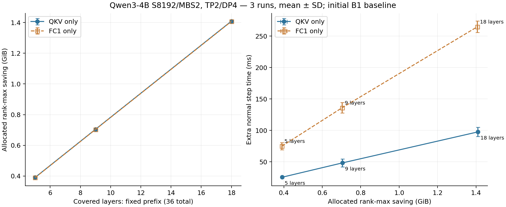
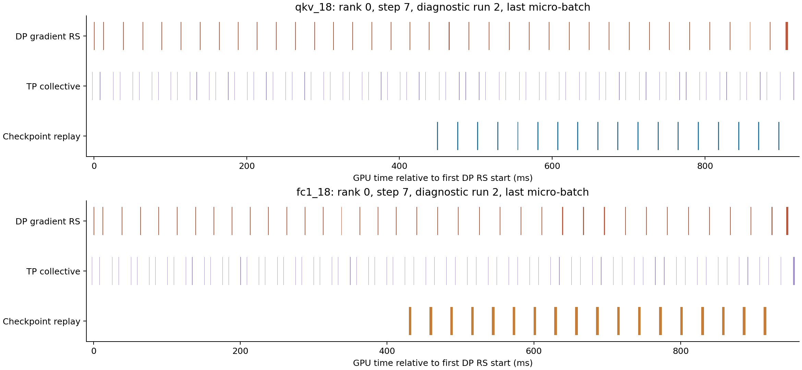

# Qwen3-4B 阶段 C：细粒度重计算的显存成本与原生RS交集

## 1. 核心摘要（Executive Summary）

本轮先测量QKV-only、FC1-only重计算的显存节省和训练开销，再按预设门槛决定是否扩展覆盖、采集通信诊断或探测MBS4。**QKV 18层节省1.409GiB（2.27%），增时97.58ms（1.66%）；FC1相近节省的增时为264.88ms。** 建议有限保留QKV作为小额显存补偿；当前NO-GO开发窗口感知调度器或进入完整P2。

- **局部近似线性。** 固定前缀5/9/18层的显存节省约80.2MiB/层；两类模块均首次在18层过门槛，36层未测。
- **正确性先行。** 全8rank、三步完整有效RS梯度分片和更新后全部参数对照通过；实际重放次数符合配置。
- **未观察到RS覆盖重放计算。** 9份修复后主NSYS中，两策略重放与37个梯度bucket的GPU kernel交集均为0；FC1窄GEMM位置比为0.9995 ± 0.0003，未重复约1.8倍减速。
- **MBS4未进入探测。** 当前已测节省未通过容量筛选，外推值约107GiB；本轮没有MBS4能够运行的实测证据。

## 2. 实验环境与方法

| 项目 | 固定配置 |
|---|---|
| 硬件 | 单机8×A100-SXM4-80GB，NV12；驱动570.172.08 |
| 模型 | Qwen3-4B真实预训练权重，36层，hidden2560，FFN9728，32Q/8KV heads、head_dim128；mock token |
| 主负载 | Seq8192、MBS2、GBS32；TP2/DP4、PP1、CP1；每step4个累积micro-batch，编号0–3 |
| 精度与优化器 | BF16、Distributed Optimizer；Adam lr1e-4、betas(0.9,0.95)、weight decay0.1、clip-grad1 |
| 通信 | 原生异步梯度RS；40M元素目标bucket、FP32梯度；参数AG重叠关闭；SP关闭 |
| 运行设置 | seed1234，CUDA_DEVICE_MAX_CONNECTIONS=1，OMP_NUM_THREADS=4 |
| 软件 | PyTorch 2.7.0a0+79aa17489c.nv25.04，CUDA runtime12.9，NCCL2.26.3，TE2.2.0+c55e425，NSYS2025.2.1 |

**QKV-only与FC1-only沿用已有融合投影边界，重放包含LayerNorm与Linear。** 它们不包含Attention core、Q/K norm、SwiGLU或FC2，也不是GEMM内部Tile拆分。新增脚本只做权重加载、验证及观测，保持原训练调度。

| 子阶段 | 执行规则 |
|---|---|
| C1 小范围成本 | 新B1、QKV0–4、FC1 0–4；各3次20+30；先做3步完整验证和基线重复性验证 |
| C2 覆盖扩展 | 前缀0..n−1，n=9/18/36；每类模块首次达到门槛后停止；新增策略各先验证再3次20+30 |
| C3 通信诊断 | 仅过门槛策略及B1；各3次NSYS，warmup5，采6–8步，总10步；FC1另做窄GEMM Event控制 |
| C4 OOM验证 | 根据实测节省预筛选MBS4容量，预测allocated≤77GiB才探测；成功才进入3次20+30 |

收益门槛在C1结果产生前固定：三次对应编号的B1减策略差值均为正，平均allocated节省≥1GiB且≥B1的1%，并超过配对节省SD的3倍。该门槛用于限制实验预算，不是统计显著性检验。

正常步时取每运行30步中位数，再报告三个运行之间的均值±样本SD；吞吐按正式名义token数/总步时。显存在剔除warmup后取8rank×30步的最大allocated/reserved峰值，再跨运行汇总。reserved不等同活跃张量占用。

显存成本关注分布式训练瓶颈：节省1GiB指全rank最大峰值下降1GiB，不是把8卡节省相加。令ΔM=M_B1−M_policy、ΔT=T_policy−T_B1，则单位成本为ΔT/ΔM，单位为ms/GiB；差值按重复编号对应，主基线始终为本轮初始B1。

## 3. 正确性与观测完整性验证

验证专用运行使用TE确定性反向与固定cuBLAS workspace，保持P1原始梯度/参数容差。每步在梯度归约完成、optimizer unscale/clip前读取本rank拥有的完整RS输出分片，参数在更新与同步完成后逐张量比较。

| 配置/验证 | rank覆盖 | 最大绝对误差 | 超容差元素 | 每rank每step重放次数 |
|---|---:|---:|---:|---:|
| B1 无重计算 | 8 | 参考保存 | — | 0 |
| B1重复 | 8 | 0.0 | 0 | 0 |
| QKV 5层 | 8 | 0.0 | 0 | 20 |
| QKV 9层 | 8 | 0.0 | 0 | 36 |
| QKV 18层 | 8 | 0.0 | 0 | 72 |
| FC1 5层 | 8 | 0.0 | 0 | 20 |
| FC1 9层 | 8 | 0.0 | 0 | 36 |
| FC1 18层 | 8 | 0.0 | 0 | 72 |

梯度atol=1e-5、rtol=1e-3；BF16参数atol=1e-3、rtol=1e-2。全部DP rank的拥有分片并集覆盖完整padded梯度buffer；每rank全部290个模型参数张量均比较，不使用局部抽样。B1行是参考保存，其重复运行才是基线自比较。

正式运行不启用验证专用确定性开关，也不加载完整梯度比较或NSYS。正常运行逐步检查loss、日志梯度范数、跳步/NaN状态和全rank结束状态；数值结论仅限上述三步对照范围。

修复了一次采样前的观测包装异常后，主诊断使用同一修正版观察器重新采集；未重跑正式性能。NSYS核查所有rank的micro-batch、重放次数、communicator成员、类型、字节数和bucket调用顺序。DP梯度RS与TP All-Reduce、参数All-Gather分开归属；实际重放模块内的NCCL与CUPTI缺失告警单独审计。

## 4. 性能评估与定量测量

### 4.1 正常整步耗时与显存

全部主负载相同；每行3次独立运行，差值及比例以本轮初始B1为基线。共21次主正式运行及3次末端B1控制，均为20warmup＋30正式步。

| 配置 | 层覆盖率 | 整步ms，均值±SD | 增时ms（%） | token/s，均值±SD |
|---|---:|---:|---:|---:|
| B1 无重计算 | 0.0% | 5878.75 ± 1.67 | 0.00 ± 0.00（+0.00%） | 44574 ± 28（+0.00%） |
| QKV 5层 | 13.9% | 5904.30 ± 1.69 | 25.55 ± 1.14（+0.43%） | 44398 ± 12（-0.39%） |
| QKV 9层 | 25.0% | 5927.08 ± 4.78 | 48.33 ± 6.15（+0.82%） | 44217 ± 46（-0.80%） |
| QKV 18层 | 50.0% | 5976.33 ± 8.72 | 97.58 ± 7.22（+1.66%） | 43855 ± 56（-1.61%） |
| FC1 5层 | 13.9% | 5953.68 ± 3.98 | 74.93 ± 5.59（+1.27%） | 44018 ± 21（-1.25%） |
| FC1 9层 | 25.0% | 6014.82 ± 8.27 | 136.07 ± 8.50（+2.31%） | 43564 ± 51（-2.26%） |
| FC1 18层 | 50.0% | 6143.63 ± 8.91 | 264.88 ± 9.07（+4.51%） | 42673 ± 60（-4.26%） |

| 配置 | allocated GiB | reserved GiB | allocated节省GiB（%） | 额外ms/GiB，均值±SD |
|---|---:|---:|---:|---:|
| B1 无重计算 | 62.075960 ± 0.000779 | 76.124 ± 0.063（+0.00%） | 0.000 ± 0.000（0.000%） | — |
| QKV 5层 | 61.684908 ± 0.001073 | 76.155 ± 0.028（+0.04%） | 0.391 ± 0.002（0.630%） | 65.33 ± 2.64 |
| QKV 9层 | 61.371187 ± 0.000279 | 75.306 ± 0.634（-1.08%） | 0.705 ± 0.001（1.135%） | 68.58 ± 8.68 |
| QKV 18层 | 60.666638 ± 0.000247 | 74.859 ± 0.670（-1.66%） | 1.409 ± 0.001（2.270%） | 69.24 ± 5.15 |
| FC1 5层 | 61.686292 ± 0.001068 | 75.667 ± 0.376（-0.60%） | 0.390 ± 0.002（0.628%） | 192.28 ± 13.94 |
| FC1 9层 | 61.372449 ± 0.000458 | 75.889 ± 0.492（-0.31%） | 0.704 ± 0.001（1.133%） | 193.40 ± 11.92 |
| FC1 18层 | 60.668286 ± 0.000035 | 75.034 ± 0.804（-1.43%） | 1.408 ± 0.001（2.268%） | 188.17 ± 6.36 |

末端B1三次复测的步时中位数均值为5887.15±8.24 ms，比初始B1变化+8.40 ms（+0.143%）。主比较保持初始B1，末端数据只检验时间漂移。以末端均值作敏感性参照，QKV18/FC118的增时分别为89.18/256.48ms；排序不变。

### 4.2 覆盖扩展决策

| 策略 | 平均节省GiB | 相对B1 | 预注册决策 |
|---|---:|---:|---|
| QKV 5层 | 0.391 | 0.630% | 未过门槛，继续预设覆盖 |
| FC1 5层 | 0.390 | 0.628% | 未过门槛，继续预设覆盖 |
| QKV 9层 | 0.705 | 1.135% | 未过门槛，继续预设覆盖 |
| FC1 9层 | 0.704 | 1.133% | 未过门槛，继续预设覆盖 |
| QKV 18层 | 1.409 | 2.270% | 继续诊断并停止扩展 |
| FC1 18层 | 1.408 | 2.268% | 继续诊断并停止扩展 |

未执行的更大覆盖属于预设停止规则，不代表失败或收益为零。

### 4.3 与历史0.6B五层策略对照

| 模块/覆盖 | 0.6B Seq2048/MBS1节省 | 4B Seq8192/MBS2节省 | 绝对量之比 |
|---|---:|---:|---:|
| QKV，5层 | 20.48 ± 1.40 MiB | 0.391 ± 0.002 GiB | 19.55倍 |
| FC1，5层 | 20.46 ± 1.28 MiB | 0.390 ± 0.002 GiB | 19.50倍 |

五层绝对节省约为历史0.6B的19.5倍；相对本轮峰值仍仅约0.63%。模型宽度、序列与MBS同时变化，不将该比值单独归因于模型规模。

### 4.4 独立NSYS与FC1 Event诊断

通信驻留是DP梯度RS kernel区间并集的长度，重放成本是实际checkpoint前向重放kernel区间并集的长度。两者交集表示时间重合，不能直接当作净隐藏时间。

记D、R为上述两个区间集合，报告|D|、|R|、|D∩R|及交集占|R|的比例。以下先在每次采集中平均8rank×3步，再跨3次采集报告均值±SD，不用于正常步时排名。

| 配置 | 重放GPU ms | RS驻留ms | RS占诊断整步 | 重放∩RS ms | 交集/重放 |
|---|---:|---:|---:|---:|---:|
| B1 无重计算 | 0.000 ± 0.000 | 84.005 ± 6.135 | 1.434 ± 0.103% | 0.000 ± 0.000 | — |
| FC1 18层 | 252.145 ± 0.416 | 90.605 ± 7.979 | 1.481 ± 0.127% | 0.000 ± 0.000 | 0.000% |
| QKV 18层 | 93.777 ± 0.069 | 89.215 ± 1.517 | 1.497 ± 0.026% | 0.000 ± 0.000 | 0.000% |

| 配置 | micro-batch | 重放GPU ms | 重放∩RS ms |
|---|---:|---:|---:|
| B1 无重计算 | 0 | 0.000 ± 0.000 | 0.000 ± 0.000 |
| B1 无重计算 | 1 | 0.000 ± 0.000 | 0.000 ± 0.000 |
| B1 无重计算 | 2 | 0.000 ± 0.000 | 0.000 ± 0.000 |
| B1 无重计算 | 3 | 0.000 ± 0.000 | 0.000 ± 0.000 |
| FC1 18层 | 0 | 63.001 ± 0.110 | 0.000 ± 0.000 |
| FC1 18层 | 1 | 63.085 ± 0.124 | 0.000 ± 0.000 |
| FC1 18层 | 2 | 63.100 ± 0.101 | 0.000 ± 0.000 |
| FC1 18层 | 3 | 62.960 ± 0.085 | 0.000 ± 0.000 |
| QKV 18层 | 0 | 23.428 ± 0.018 | 0.000 ± 0.000 |
| QKV 18层 | 1 | 23.476 ± 0.015 | 0.000 ± 0.000 |
| QKV 18层 | 2 | 23.483 ± 0.018 | 0.000 ± 0.000 |
| QKV 18层 | 3 | 23.390 ± 0.024 | 0.000 ± 0.000 |

| 配置 | 各rank平均RS驻留最小–最大ms |
|---|---:|
| B1 无重计算 | 34.230–128.853 |
| FC1 18层 | 36.001–136.118 |
| QKV 18层 | 36.699–131.464 |

窄GEMM Event在原样TE generic_gemm调用两侧记录当前stream span，独立于NSYS运行。每层、rank、step将mb3时长除以mb0–2的中位数；再汇总为每运行中位数及运行间SD。

| 配置 | 执行位置 | 早期mb中位ms | mb3中位ms | mb3/早期位置比 |
|---|---|---:|---:|---:|
| B1 无重计算 | 原始前向 | 3.1632 ± 0.0003 | 3.1654 ± 0.0010 | 1.0003 ± 0.0001 |
| FC1 18层 | 原始前向 | 3.1648 ± 0.0002 | 3.1703 ± 0.0014 | 1.0002 ± 0.0001 |
| FC1 18层 | 重放 | 3.2727 ± 0.0003 | 3.2708 ± 0.0002 | 0.9995 ± 0.0003 |

### 4.5 MBS4容量预筛选与实际执行状态

| 策略 | 外推MBS4 allocated GiB（非实测） | 实际执行状态 |
|---|---:|---|
| QKV 18层 | 106.7 | 跳过；预测超过77GiB筛选线 |
| FC1 18层 | 106.7 | 跳过；预测超过77GiB筛选线 |

## 5. 深度分析与机制探讨

### 5.1 显存收益为何受重计算边界限制

**代码事实：** TE融合投影在正常前向保存归一化后的hidden供权重梯度使用，checkpoint首遍无梯度前向不保存这份缓存。投影输出仍需被下游算子使用；因此重放大GEMM不等于释放整个大输出。

**结构性解释：** 在本配置中，一份BF16 hidden激活体积为8192×2×2560×2byte=80MiB。实测约80.2MiB/层与这一规模接近，支持“主要移除内部hidden缓存”的解释；峰值分配栈尚未单独分解。

QKV和FC1的本地权重形状分别为3072×2560和9728×2560。二者可能移除相近规模的hidden缓存，却需要重放不同规模的矩阵计算；单位显存成本比裸GEMM耗时更适合评估其训练价值。

### 5.2 只在已测覆盖范围讨论线性

下表对已测覆盖的均值作描述性直线拟合，R²只描述这些点，不代表对未测36层的预测或统计证明。

| 模块 | 已测层数 | 显存斜率MiB/层 | 显存R² | 额外耗时斜率ms/层 | 时间R² |
|---|---|---:|---:|---:|---:|
| qkv | 5, 9, 18 | 80.200 | 0.99999981 | 5.529 | 0.99991 |
| fc1 | 5, 9, 18 | 80.176 | 0.99999956 | 14.561 | 0.99976 |

已测5/9/18层的allocated节省与额外步时均近似线性；reserved不单调，不能用保留量替代活跃缓存数量。时间边际量仍可能受到GEMM效率、host开销、原始前向路径变化和通信等待影响。主性能数据与独立诊断共同用于解释，不把两种测量直接相减估计“被隐藏开销”。

### 5.3 原生RS可覆盖多少实际重放

**直接实测：** 重放分布于mb0–3，梯度RS仅在mb3启动。两策略各72个rank-step的实际重放与全部37个梯度bucket交集均为0；RS仍与其他原始反向计算重合，不能据此称异步RS整体无效。

依赖链为：本地重放→该权重梯度→bucket就绪→本bucket的RS。因此本bucket不能隐藏生成自身梯度所必需的重放；可用机会只能来自其他已就绪bucket，当前按需执行未观察到这种交集。

图为固定rank0、第7步、第二次诊断的单样本；仅画GPU kernel区间，不填充通信间隙，不代表全rank平均值。

只有mb3的重放可能遇到本步RS。即使假设它能任意填入RS窗口，按采样成本可覆盖量也至多为较短的一方：U=min(|D|,|R_mb3|)。这是忽略层依赖、排队和争用的容量松弛估计，不代表可达加速。

| 配置 | mb3重放ms | 宽松容量估计U ms | U占诊断整步 | 实际交集ms |
|---|---:|---:|---:|---:|
| FC1 18层 | 62.960 ± 0.085 | 56.303 ± 0.388 | 0.920 ± 0.004% | 0.000 ± 0.000 |
| QKV 18层 | 23.390 ± 0.024 | 23.390 ± 0.024 | 0.393 ± 0.000% | 0.000 ± 0.000 |

实际总重放为QKV约93.8ms、FC1约252.1ms，而正常整步开销均增加。总RS与重放时长即使同量级，也不能替代micro-batch和bucket依赖分析。

本轮不构造关闭overlap的Recompute Only对照，因为它会改变bucket划分；也不开发同bucket强制同步或主动重放调度。当前数据可以判定实际执行位置的交集规模，不能识别严格串行反事实下的净通信隐藏收益。

**FC1未重复历史减速幅度。** 窄GEMM重放位置比为0.9995 ± 0.0003；全部配对中超过1.25的比例为0。它不证明FC1适合通信并发：本轮没有观察到RS与重放并发，SM/HBM资源争用未被直接测试。

### 5.4 MBS4估计的含义

OOM报错只显示最先失败的一次申请，不能将该申请大小视作整步需要补齐的全部显存。预筛选因此使用成功负载的峰值变化趋势。

先用相同Seq下的B1 MBS1/2峰值估计MBS4基线，再假定checkpoint节省随MBS倍增：预测M4≈3M2−2M1−2ΔM2。本轮无重算MBS4估计为约109.5GiB；筛选线77GiB预留设备容量余量。

该模型仅用于决定是否值得冒OOM进行探测，不能替代实际运行，也不能证明更大覆盖或其他边界无法使MBS4运行。

## 6. 局限性、决策建议与后续工作

**有限GO保留QKV显存补偿；FC1不优先；当前NO-GO主动通算调度或完整P2。** 在已测相近峰值节省下，QKV额外时间约为FC1的三分之一。当前固定负载所有重计算策略均增加步时，未证明更大batch可运行或通信隐藏带来的端到端收益。

- 性能、显存和正确性只覆盖所列BF16单机TP2/DP4、PP1负载、固定前缀层集合及mock token；完整数值对照为三步确定性验证，不证明长期收敛或所有非确定性kernel逐元素等价。
- 历史0.6B与当前4B同时改变模型宽度、Seq、MBS、累积次数及初始化；绝对收益之比不是模型规模的单因子因果效应。
- 覆盖扩展按门槛停止，未测比例不能用拟合代替。初始B1用于主比较，扩展阶段未与新B1同期区组配对；末端B1仅作漂移敏感性，不按结果择优替换。时间拟合为描述性结果，不能排除时序混杂。
- NSYS预热5步、正式性能预热20步；profiler及标签可能改变短窗口提交相位，零交集结论限采样时间线。Event为stream span、NSYS为kernel区间，不把二者混为同一算子耗时。
- NCCL驻留包含等待；无非NCCL交集时也可能有TP通信。Work.wait CPU区间不代表GPU空闲或关键路径暴露，交集不直接等于净隐藏收益。
- SM/HBM计数器、NVML峰值及严格同bucket串行反事实未测量；无法把位置减速直接归因于资源竞争。
- 容量松弛估计固定micro-batch顺序与采样重放成本，忽略层依赖、bucket顺序、stream排队及资源竞争，既不是可实现调度也不是净隐藏收益。
- MBS4预筛选使用线性外推假设。未触发探测时，结论是“本轮未验证MBS4”，不是“重计算必然无法解决OOM”。

后续仅建议审阅后按优先级决定：先评估实测单位显存成本较低的模块是否有实际预算用途；再考虑更能释放下游激活的边界；只有真实时间线与端到端对照支持时，才另行讨论通信调度。当前不自动执行这些工作。

## 7. 附录：数据溯源与档案索引

| 证据 | 文件/字段（相对本报告目录） |
|---|---|
| 执行规则 | `../../plans/QWEN3_4B_STAGE_C_PROTOCOL.md`，`protocol.json`，`strategies.json`，`baseline_refresh_protocol.json`；coverage集合和门槛在相应结果产生前固定 |
| 源码/环境 | `commit.txt`、`git_status.txt`、`source.txt`、`source_hashes.json`、`gpu.txt`、`topology.txt`、`packages.txt`、`software_versions.json`、`nsys_version.txt` |
| 权重 | `source_weights.json`记录两个TP权重文件SHA256及HF来源分片SHA256；复用`../qwen4b_ab_20261118/converted/`；加载记录见各运行`weight_load_rank*.json` |
| 完整数值基线 | `verify_B1_m2_r1/reduced_gradients_step{1..3}_rank{0..7}.pt`、`parameters_step{1..3}_rank{0..7}.pt`；全部拥有RS分片、全部模型参数 |
| 验证结果 | 各`verify_*/verification_rank*.json`的`checks/replays/bucket_layout`；`verification_summary.json`汇总；容差保存在原始checks和`protocol.json` |
| 命令与原始日志 | 各运行`manifest.json`内`command/environment/tool_hashes`，`train.log`、`rank_logs/*/attempt_0/{0..7}/stdout.log`和`stderr.log`；退出码及运行总时长见各`status.json` |
| 正常性能 | `performance.json`的逐步`step_ms/loss/grad_norm`、逐rank峰值和运行内中位数；各`perf_*/memory_rank_*.json`逐步峰值；`performance_summary.json`的节省、增时与ms/GiB |
| 漂移控制 | `refresh_status.json`、`refresh_performance.json`，各`refresh_*/`完整命令与日志；主比较始终用初始B1 |
| 历史对照 | `historical_comparison.json`；源`../dp_overlap_p1_20261118_run2/performance_summary.json`的`paired_allocated_saving_mib`；P1报告保留原始范围 |
| 覆盖决策/拟合 | `status.json.decisions`、`selected.json`、`coverage_response.json`；仅已测均值作描述性拟合 |
| 时间线原件 | 各`profile_*/trace.nsys-rep`、`trace.sqlite`；`observation_rank*.json`保留事件及communicator/bucket元数据；`communications_gpu.json`保留bucket ready、提交、GPU开始/结束及通信类型/字节数 |
| 容量松弛分析 | `window_capacity_records.json`、`window_capacity_summary.json`：mb3重放区间并集、min(D,R_mb3)及诊断整步比例；假设随文件归档 |
| 逐bucket交集 | `bucket_overlap_records.json`、`bucket_overlap_summary.json`：全部37个bucket的输入字节、成员、参数层、实际重放交集与mb；两策略全部0 |
| TE保存机制 | `TE_layernorm_linear_reference.py`及`TE_saved_tensor_evidence.json`保存原始库源码SHA256、保存条件与缓存体积；主峰值归因仍未做内存栈采集 |
| 区间分析 | 各`steps.json`的`replay_ms/dp_union_ms/actual_intersection_ms/mb_replay_ms`、`tasks.json`逐层逐mb重放区间；`trace_runs.json`、`trace_summary.json`为运行内及运行间汇总 |
| 观测修复与主样本选择 | `observer_fix.json`、`diagnostic_recovery/`保留ctx=None包装异常、旧代码与日志；`profile_selection.json`指定修复后主诊断、修复前参考及失败；`continuation_manifest.json`记录21次正式运行复用 |
| 完整性审计 | 各诊断`audit.json`、`diagnostics.json`，`analysis_progress.json`与`analysis_status.json`；DP与TP分开分类，重放模块内NCCL单独筛查 |
| FC1轻量诊断 | 各`events_*/events_rank*.json`；`event_position_pairs.json`、`event_runs.json`、`event_summary.json`；`event_low_reference_runs.json`为固定0–4子集，注册规则见`event_analysis_protocol.json`；原样TE generic_gemm Event，形状/dtype在原始事件中 |
| OOM门槛/失败 | `mbs4_gate_corrected.json`为更正后的MBS4估计、阈值和probe状态；`protocol.json`保留初始旧公式；恢复编排器在实际筛选前采用更正公式，结果同时记录于`mbs4_gate.json`，`capacity_formula_correction.json`及`mbs4_preflight_corrected.json`记录修正与继续决策核对；失败列表见`status.json.failed`及对应运行原始日志；未测量不记作OOM |
| 图表 | `memory_time_tradeoff.png/.pdf`来自正式性能JSON；`actual_replay_timeline.png/.pdf`来自固定样本原始GPU区间，索引`timeline_figure_source.json` |
| 工具及最终审计 | `tools_initial/`、`ab_tools_initial/`保存启动时源码；`tools_final/`及`analysis_reference/`保存收尾工具；`final_validation.json`记录源版本、权重、运行完整性、报告SHA256及工具SHA256；`postrun_orchestrator_formula_fix.json`说明未来编排器公式修正，实际原编排代码仍保存在`tools_initial/suite.py`；`execution_commands.json`记录编排入口，`orchestrator_*.log`和`diagnostic_recovery/`保留全部编排与失败日志 |

统计SD的独立单位为运行，3运行×8rank×3诊断步不是72次独立实验。C_REPORT.md为本报告的同内容入口。
